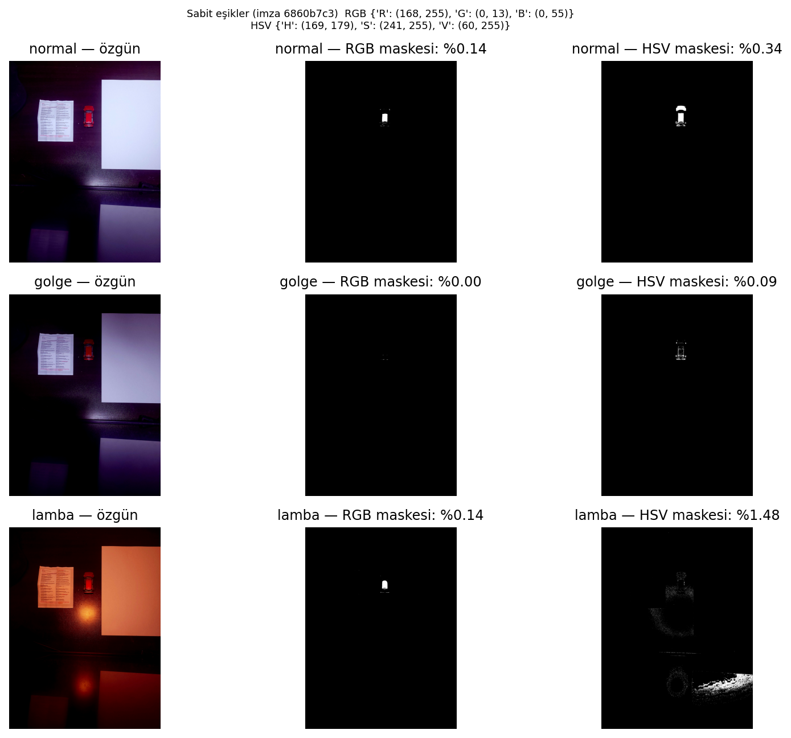
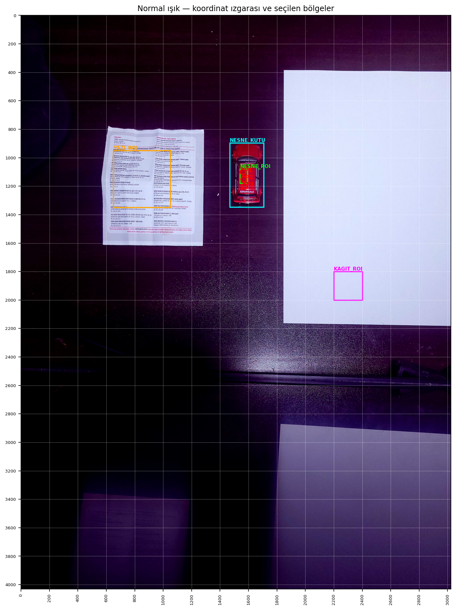
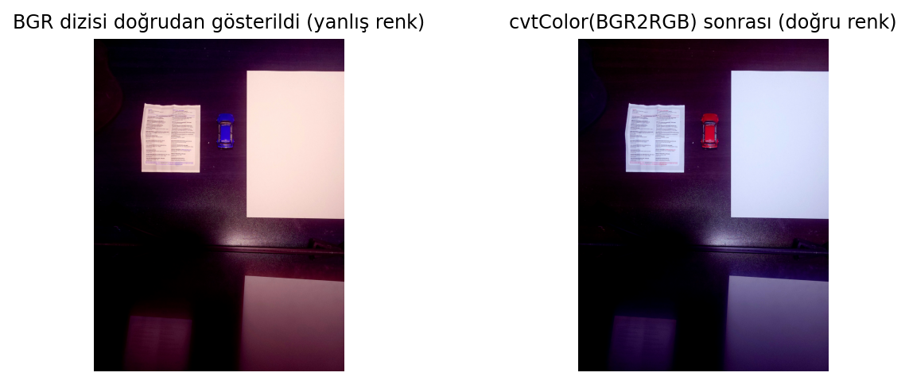
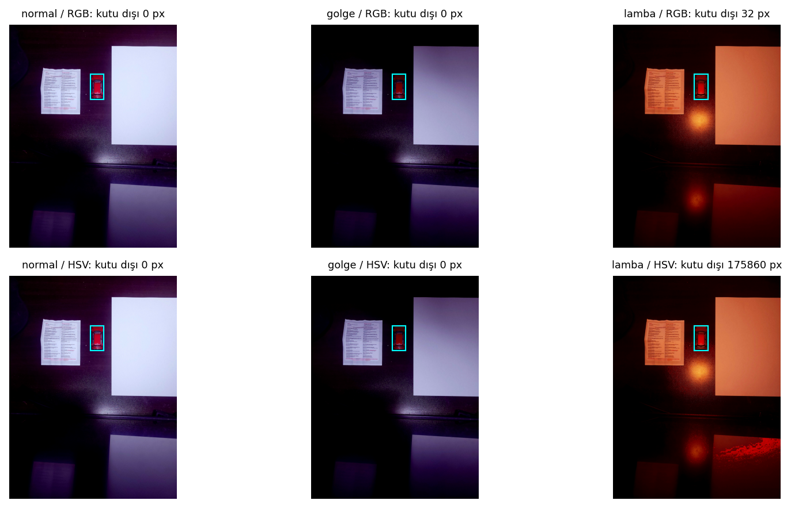
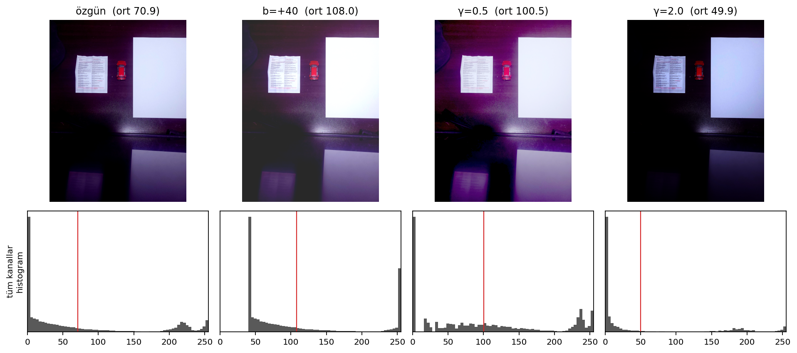
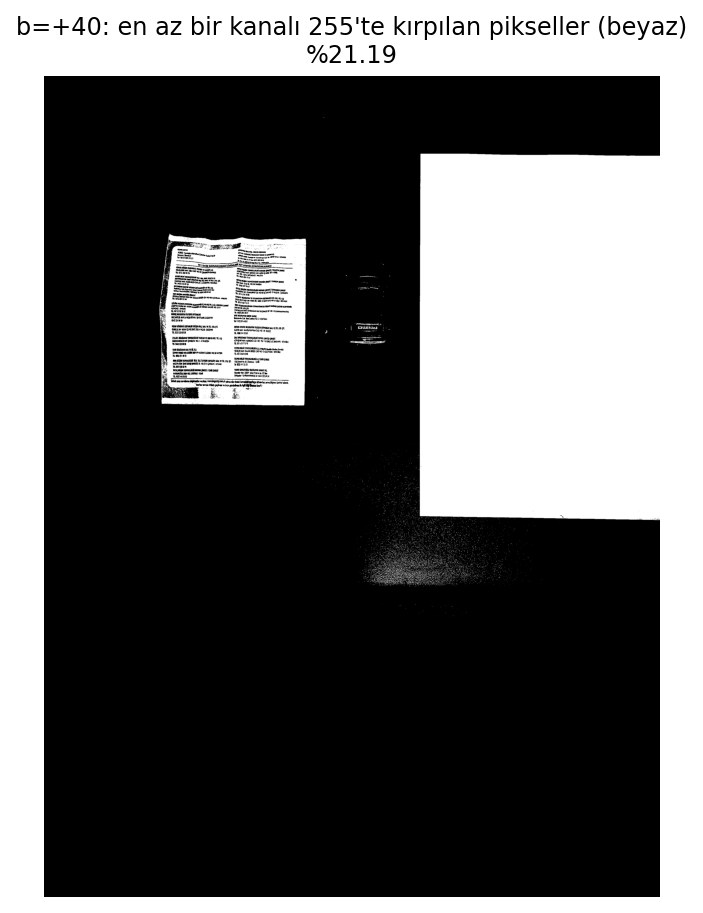
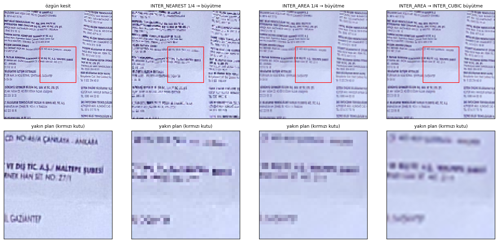
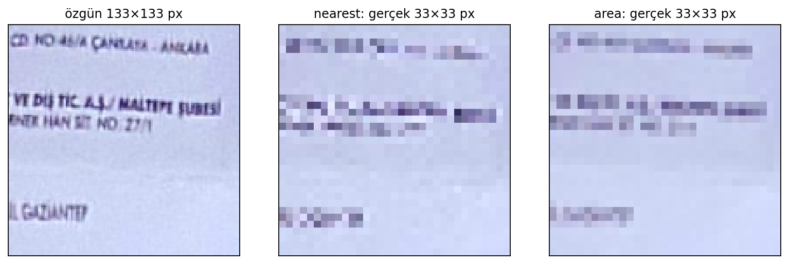

# Renk, Aydınlatma ve Örnekleme — Işık Değişince Görüntüde Ne Değişir?

**YZM411 Bilgisayarlı Görü · Ödev 1**
Umut Barbaros BABAHAN — 230212065 · OSTİM Teknik Üniversitesi, Yapay Zeka Mühendisliği

Sabit bir kamerayla, yalnızca ışığı değiştirerek (normal, gölge, sıcak masa lambası) aynı sahnenin üç fotoğrafını çektim. Bu fotoğraflar üzerinde dört deney yürüttüm. Deneyler; piksel değerlerinin, sabit renk eşiklerinin, parlaklık/gama dönüşümlerinin ve küçültmenin ışığa nasıl tepki verdiğini ölçüyor.

> **Öne çıkan bulgu:** Normal ışıkta kırmızı arabayı kusursuz bulan sabit eşikler, ışık değişince tutmadı. RGB eşiği gölgede arabayı tamamen kaybetti. HSV eşiği ise hem gölgede hem lambada kaybetti, çünkü kırmızının tonu 174'ten 0'a "sardı". Lamba altında HSV maskesinin seçtiği piksellerin %97,6'sı arabanın dışındaydı.



---

## İçindekiler

- [Deney düzeni](#deney-düzeni)
- [D4 — Görüntünün sayısal yapısı](#d4--görüntünün-sayısal-yapısı)
- [D5 — Sabit renk eşikleri](#d5--sabit-renk-eşikleri)
- [D6 — Parlaklık ve gama](#d6--parlaklık-ve-gama)
- [D7 — Küçültmenin etkisi](#d7--küçültmenin-etkisi)
- [Çalıştırma](#çalıştırma)
- [Klasör yapısı ve çıktılar](#klasör-yapısı-ve-çıktılar)
- [Kaynak beyanı](#kaynak-beyanı)

---

## Deney düzeni

| | |
|---|---|
| **Sahne** | Koyu masa üzerinde kırmızı oyuncak araba, basılı servis listesi, beyaz A4 kâğıt |
| **Işık koşulları** | `normal.jpg` · `golge.jpg` · `lamba.jpg` |
| **Kamera** | Samsung S20 FE arka kamera, 12 MP, 4032 × 3024 px |
| **Ayarlar** | Pro mod: ISO 200, F1.8, 1/30 s, 0,0 EV, beyaz dengesi 5000 K **kilitli** |
| **Otomatik pozlama / beyaz dengesi** | Kapalı. Üç fotoğraf arasındaki tek fark ışık |

Bütün parametreler tek bir ayar hücresinde tutuluyor. Her deneyden önce bir tahmin yazılması zorunlu: tahmini olmayan deney çalışmıyor. Renk eşikleri yalnızca normal fotoğraftan hesaplanıp donduruluyor ve tüm ölçümler CSV/JSON olarak kaydediliyor.



*Piksel ve bölge koordinatları bu ızgaradan okunuyor. NESNE_ROI eşik hesabı, NESNE_KUTU nesne dışı seçim sayımı, KAGIT_ROI ışığın rengi, YAZI_ROI ise küçültme deneyi için kullanılıyor.*

---

## D4 — Görüntünün sayısal yapısı

Görüntüler `(4032, 3024, 3)` boyutunda, `uint8` türünde ve 0–255 aralığında. NumPy önce satırla (y), sonra sütunla (x) indeksliyor; OpenCV ise kanalları **B, G, R** sırasıyla okuyor.



*BGR dizisi doğrudan gösterildiğinde kırmızı araba mavi görünüyor. Aynı noktada `img[1100, 1560]` (doğru) = (38, 0, 191) BGR iken `img[1560, 1100]` (x ve y ters) bambaşka bir piksel veriyor: (234, 200, 194).*

Arabanın aynı noktası üç ışıkta (5×5 ortalama, RGB):

| Işık | R | G | B | Ton (H) |
|---|---|---|---|---|
| Normal | 190,8 | 0,5 | 37,8 | 174 |
| Gölge | 100,4 | 0,2 | 2,0 | **0** |
| Lamba | 189,3 | 0,2 | 0,7 | **0** |

Gölgede R yarıya iniyor. Lambada R korunuyor ama mavi bileşen kayboluyor. İki durumda da renk mor-kırmızıdan saf kırmızıya kayıyor ve ton 0/179 sınırının öbür tarafına geçiyor. Kâğıt bölgesi ışığın rengini doğruluyor: lambada R/G = 1,97, B/G = 0,67, yani çok sıcak bir ışık.

---

## D5 — Sabit renk eşikleri

Eşikler normal fotoğraftaki küçük bir nesne bölgesinden (2.–98. yüzdelik) hesaplanıp donduruldu:

- **RGB:** R ≥ 168, G ≤ 13, B ≤ 55
- **HSV:** H ∈ [169, 179], S ≥ 241, V ≥ 60

| Fotoğraf | Yöntem | Alan oranı | Nesnenin tutulan kısmı | Seçilenlerin nesne dışı payı |
|---|---|---|---|---|
| normal | RGB | %0,145 | %100,0 | %0,0 |
| normal | HSV | %0,338 | %100,0 | %0,0 |
| gölge | RGB | %0,003 | %0,0 | %0,0 |
| gölge | HSV | %0,089 | %9,8 | %0,0 |
| lamba | RGB | %0,138 | %98,8 | %0,2 |
| lamba | HSV | %1,478 | %0,1 | **%97,6** |



*Kırmızı: maskenin seçtiği ama nesne kutusunun dışında kalan pikseller. Lamba altında HSV maskesi arabayı kaçırıp alt sağdaki kâğıdı ve lamba yansımasının çevresini seçiyor.*

**Neden?** HSV'nin "parlaklıktan bağımsız ton" avantajı burada işe yaramadı, çünkü değişen şey parlaklık değil tonun kendisiydi. Kırmızı, ton dairesinin 0/179 sınırında duruyor. Normal ışıkta 174 olan ton, gölgede ve lambada 0'a geçti; dondurulmuş [169, 179] aralığı bu tarafı görmüyor. Kırmızı için iki parçalı bir ton aralığı (H ≥ 165 veya H ≤ 10) ya da r = R/(R+G+B) gibi parlaklıktan bağımsız bir kromatiklik ölçüsü bu sorunu çözer.

---

## D6 — Parlaklık ve gama

```
J = clip(I + b, 0, 255)          J = 255 · (I / 255)^γ
```



| Dönüşüm | Özgün ort. | Yeni ort. | Değişim | Formül ortalamaya uygulanırsa |
|---|---|---|---|---|
| b = +40 | 70,88 | 107,98 | +37,10 | 110,88 |
| γ = 0,5 | 70,88 | 100,55 | +29,67 | 134,44 |
| γ = 2,0 | 70,88 | 49,94 | −20,94 | 19,70 |

- **b = +40:** Piksellerin %21,19'unun en az bir kanalı 255'te kırpıldı (çoğu beyaz kâğıt). Bu yüzden artış +40 değil +37,10. Defter bunu `assert` ile birebir doğruluyor: 70,88 + 40 − 2,90 = 107,98.
- **Gama:** Ortalamanın gaması ≠ gamanın ortalaması (Jensen eşitsizliği). Histogram iki tepeli: pikseller koyu masada 0'a, kâğıtlarda 255'e yakın, ve bu iki uç gamada yerinden oynamıyor. Ortalama (71) ise neredeyse hiç pikselin bulunmadığı bir ara değer.

<p align="center"></p>

---

## D7 — Küçültmenin etkisi

Servis listesinden 400 × 400 px'lik bir yazı kesiti 1/4'e küçültüldü (`INTER_NEAREST` ve `INTER_AREA`), sonra karşılaştırmak için geri büyütüldü.





| Görüntü | MAE (özgüne) | Kontrast (std) | Kenar enerjisi |
|---|---|---|---|
| Özgün kesit | 0,00 | 36,68 | 24,01 |
| NEAREST 1/4 → büyütme | 19,00 | 35,96 | 10,98 |
| AREA 1/4 → büyütme | 13,90 | 28,08 | 7,43 |
| AREA 1/4 → CUBIC büyütme | 13,27 | 26,91 | 8,10 |

8 px'lik harfler ~2 px'e indi ve okunamaz hale geldi.

- **NEAREST** her 4×4 bloktan tek piksel aldığı için kontrastı koruyor, ama çizgileri koparıyor (aliasing).
- **AREA** ortalama alarak harfleri gri şeritlere dönüştürüyor, ama hatası daha düşük.
- **CUBIC** ile büyütmek görüntüyü pürüzsüzleştiriyor, kaybolan bilgiyi geri getirmiyor.

---

## Çalıştırma

### Google Colab

1. Google Drive'da `MyDrive/YZM411_Renk_Aydinlatma_Ornekleme/` klasörünü oluşturun, fotoğrafları `veri/` alt klasörüne koyun.
2. Defteri Colab'da açın.
3. *Çalışma zamanı → Tümünü çalıştır*. Drive otomatik bağlanır.

### Yerel (Jupyter / VS Code)

```bash
pip install numpy opencv-python matplotlib pandas
jupyter notebook YZM411_Odev1_230212065.ipynb
```

Fotoğrafları defterin yanındaki `veri/` klasörüne koyup *Kernel → Restart & Run All* yapın. Bölüm 0.1'in hemen altındaki `drive.mount` hücresi yalnızca Colab'da çalışır; yerelde bu hücreyi atlayın.

**Kurallar:** Bütün parametreler Bölüm 0.1'de, tahminler Bölüm 0.2'de. Koordinatlar boşsa defter Bölüm 1.2'de durur: ızgaralı görüntüden koordinatları okuyup 0.1'e yazın ve yeniden çalıştırın.

---

## Klasör yapısı ve çıktılar

```
YZM411_Renk_Aydinlatma_Ornekleme/
├── YZM411_Odev1_230212065.ipynb
├── README.md
├── kaynak_beyani.md
├── veri/
│   ├── normal.jpg
│   ├── golge.jpg
│   └── lamba.jpg
└── sonuclar/          # defterin ürettiği şekiller, maskeler, CSV ve JSON dosyaları
```

<details>
<summary><b>Parametreler</b></summary>

| Parametre | Değer | Açıklama |
|---|---|---|
| `PIKSELLER` | (1560, 1100), (1565, 1150), (1570, 1200) | Araba üzerinde aynı fiziksel bölgeden 3 nokta (x, y) |
| `NESNE_ROI` | (1540, 1080, 50, 100) | Eşiklerin hesaplandığı küçük nesne bölgesi (x, y, w, h) |
| `NESNE_KUTU` | (1468, 897, 240, 450) | Arabanın tamamı; nesne dışı seçim sayımı için |
| `KAGIT_ROI` | (2200, 1800, 200, 200) | Beyaz kâğıt; ışığın rengini izlemek için |
| `YAZI_ROI` | (650, 950, 400, 400) | Küçük yazı bölgesi; küçültme deneyi için |
| `YAZI_HARF_YUKSEKLIGI_PX` | 8 | Özgün görüntüde küçük harf yüksekliği |
| `ESIK_YUZDELIK` | (2, 98) | Otomatik eşik önerisinde yüzdelikler |
| `ESIK_PAY` / `ESIK_PAY_H` | 10 / 4 | R, G, B, S ve H sınırlarına eklenen pay |
| `ESIK_V_ALT` | 60 | HSV eşiğinde V alt sınırı |
| `PARLAKLIK_B` | 40 | Parlaklık kaydırması |
| `GAMALAR` | [0.5, 2.0] | J = 255·(I/255)^γ |
| `OLCEK` | 4 | Genişlik ve yükseklikte 1/4 küçültme |

</details>

<details>
<summary><b><code>sonuclar/</code> klasöründeki dosyalar</b></summary>

| Dosya | İçerik |
|---|---|
| `goruntu_yapisi.csv` | Üç fotoğrafın boyutu, veri türü, min/max, ortalama, SHA-256 |
| `izgara_normal.png` | Koordinat ızgarası ve seçilen bölgeler |
| `bgr_rgb.png` | BGR dizisinin doğrudan ve dönüştürülmüş gösterimi |
| `piksel_degerleri.csv` | P1–P3 noktalarının üç ışıkta RGB, 5×5 ortalama ve HSV değerleri |
| `kagit_isik_rengi.csv` | Kâğıt bölgesinde R/G, B/G ve göreli parlaklık |
| `maske_<foto>_<RGB/HSV>.png` | 6 ikili maske |
| `maskeler_3x3.png` | Üç fotoğraf ve altı maske |
| `maske_oranlari.csv` | Seçilen piksel, alan oranı, nesne içi ve nesne dışı seçim |
| `nesne_roi_renk.csv` | Nesne bölgesinin üç ışıktaki ortalama renk değerleri |
| `nesne_disi_secim.png` | Nesne kutusu dışında seçilen pikseller |
| `donusum_*.png` | b = +40, γ = 0,5 ve γ = 2,0 sonuç görüntüleri |
| `donusum_olcumleri.csv` | Ortalama değişimi, kırpma oranı ve kaybı, ortalamanın gaması |
| `parlaklik_gama.png`, `kirpilan_pikseller.png` | Dönüşümler, histogramlar, kırpılan pikseller |
| `kucuk_nearest.png`, `kucuk_area.png` | 1/4 küçültülmüş yazı kesitleri |
| `kucultme_olcumleri.csv` | MAE, kontrast ve kenar enerjisi |
| `kucultme_karsilastirma.png`, `kucultme_gercek_pikseller.png` | Küçültme karşılaştırmaları |
| `sonuc_tablosu.csv` | Tahmin ↔ ölçüm tablosu |
| `parametreler.json` | Ortam, kamera notu, girdi özetleri, koordinatlar, eşikler, tahminler |

</details>

<details>
<summary><b>Çalışma ortamı</b></summary>

| Bileşen | Sürüm |
|---|---|
| Ortam | Google Colab |
| Python | 3.13.18 |
| NumPy | 2.4.6 |
| OpenCV | 5.0.0 |
| Matplotlib | 3.10.0 |
| pandas | 2.2.3 |

</details>

---

## Kaynak beyanı

Fotoğraflar, deney düzeni, tahminler ve sonuçların yorumu bana aittir. Kod; kendi çalışmam, Stack Overflow yanıtları ve Claude (Anthropic) yapay zekâ asistanının katkısıyla geliştirilmiştir. Ayrıntılar için [`kaynak_beyani.md`](kaynak_beyani.md) dosyasına bakın.
